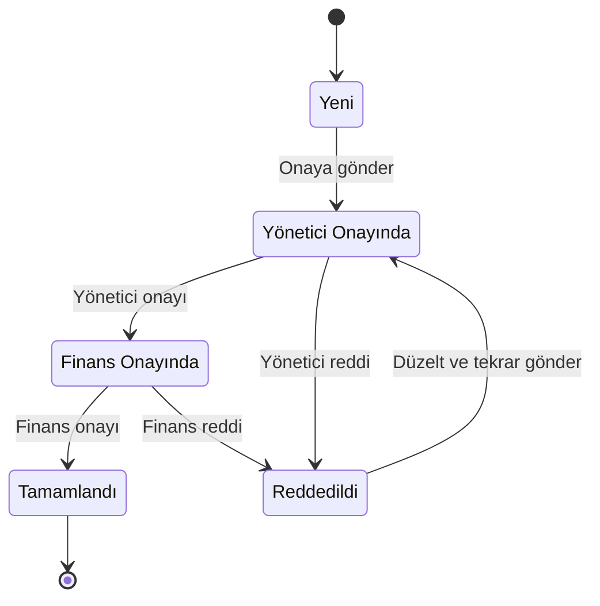

# Trafik Cezası Yönetim ve Onay Modülü

Bu projeyi Sarılar Group Junior .NET Developer case çalışması kapsamında geliştirdim. Amaç; araç ve trafik cezası kayıtlarını yönetmek, cezaları belirli bir onay akışından geçirmek ve yapılan işlemleri geriye dönük takip edebilmek.

Bir ceza önce yöneticiye, ardından finans birimine gönderiliyor. Reddedilirse personel gerekli düzeltmeleri yapıp yeniden onaya gönderebiliyor. Oluşturma, güncelleme, onay ve ret işlemleri geçmiş kaydına ekleniyor.

**Teknolojiler:** .NET 9, ASP.NET Core MVC, Entity Framework Core, SQL Server, ASP.NET Core Identity, xUnit ve Docker

## Çalıştırma

Projeyi Docker ile veya yerel ortamda çalıştırabilirsiniz.

| Yöntem | Gereksinimler | Adres |
|---|---|---|
| Docker (önerilen) | Docker Desktop | http://localhost:8080 |
| Yerel | .NET 9 SDK ve SQL Server | http://localhost:5007 |

### Docker ile çalıştırma

Docker Desktop'ın kurulu ve çalışır durumda olması yeterli. Ayrı olarak .NET SDK veya SQL Server kurmanız gerekmez.

```bash
git clone https://github.com/beyzanurcayrat/TrafficFineManagement.git
cd TrafficFineManagement
docker compose up --build
```

İlk çalıştırma, imajların indirilmesi ve projenin derlenmesi nedeniyle birkaç dakika sürebilir. Uygulama SQL Server hazır olana kadar bekler. Loglarda `Now listening on: http://[::]:8080` mesajını gördüğünüzde uygulamaya http://localhost:8080 adresinden erişebilirsiniz.

Veritabanı, tablolar ve test verileri ilk açılışta otomatik hazırlanır. Uygulamayı durdurmak için:

```bash
docker compose down
```

Veritabanı verilerini de silip temiz bir başlangıç yapmak için:

```bash
docker compose down -v
```

**Olası sorunlar**

- SQL Server en az 2 GB bellek gerektirir. `sqlserver-1 exited with code 137` hatası alırsanız Docker Desktop → Settings → Resources → Memory ayarını 4 GB yapmayı deneyin.
- M serisi Mac'lerde SQL Server emülasyonla çalıştığından Docker Desktop → Settings → General altında `Use Rosetta for x86_64/amd64 emulation` seçeneğinin açık olması gerekebilir.

### Yerel ortamda çalıştırma

.NET 9 SDK ve çalışan bir SQL Server gerekir. SQL Server kurulu değilse Docker üzerinden başlatabilirsiniz:

```bash
docker run -e "ACCEPT_EULA=Y" -e "MSSQL_SA_PASSWORD=Guclu.Sifre123" \
  -p 1433:1433 --name sqlserver -d mcr.microsoft.com/mssql/server:2022-latest
```

`sqlserver` isimli container daha önce oluşturulduysa yeniden oluşturmak yerine şu komutla başlatabilirsiniz:

```bash
docker start sqlserver
```

SQL Server'ın açılması genellikle 20–30 saniye sürer. Ardından:

```bash
cd TrafficFineManagement.Web
dotnet run
```

Uygulama http://localhost:5007 adresinde açılır. Başka bir SQL Server kullanıyorsanız `appsettings.json` içindeki bağlantı cümlesini güncelleyin. Development ortamında migration'lar uygulama başlarken otomatik uygulanır.

## Test hesapları ve roller

Development ortamında aşağıdaki hesaplar kullanılabilir. Tüm hesapların şifresi `Test123!` şeklindedir. Giriş sayfasında da test hesapları listelenir.

| E-posta | Rol |
|---|---|
| `personel@test.com` | Personel |
| `yonetici@test.com` | Yönetici |
| `finans@test.com` | Finans |
| `admin@test.com` | Admin |

| İşlem | Personel | Yönetici | Finans | Admin |
|---|:---:|:---:|:---:|:---:|
| Araç ve cezaları görüntüleme | ✓ | ✓ | ✓ | ✓ |
| Araç ekleme / düzenleme / silme | ✓ | ✓ |  |  |
| Ceza oluşturma, düzenleme ve onaya gönderme | ✓ |  |  |  |
| Yönetici onayı / reddi |  | ✓ |  |  |
| Finans onayı / reddi |  |  | ✓ |  |
| Kullanıcı yönetimi |  |  |  | ✓ |

**Onay akışını denemek için:** Personel hesabıyla bir ceza oluşturup onaya gönderin. Yönetici hesabıyla onaylayın, ardından Finans hesabıyla reddedin. Personel hesabına dönüp cezayı düzeltin ve yeniden gönderin. Sürecin adımları ceza detayındaki **Onay Geçmişi** tablosunda görünür.

## Proje yapısı

Projeyi katmanlara ayırdım ve bağımlılıkları tek yönlü tuttum:

```text
Web → Business → DataAccess → Entities
```

- **Entities:** `Vehicle`, `TrafficFine`, `FineApprovalHistory` ve `AppUser` modelleri; enum'lar ve rol sabitleri
- **DataAccess:** DbContext, Fluent API ayarları, migration'lar, repository'ler ve başlangıç verileri
- **Business:** Servisler, DTO'lar ve `FineWorkflow` içindeki onay kuralları
- **Web:** MVC controller ve view'lar, salt okunur REST API ve giriş sayfası
- **Tests:** Onay kuralları ve servis senaryolarına yönelik unit testler

Servis ve repository'leri interface'ler üzerinden dependency injection ile kullanıyorum. Controller'larda iş kurallarını tutmak yerine ilgili servisi çağırıp sonucu ekrana iletiyorum.

## Onay süreci



Onay kurallarını `FineWorkflow` sınıfında topladım. Hangi rolün hangi durumda işlem yapabileceği ve işlem sonrasında hangi duruma geçileceği burada tanımlı. Yeni bir onay aşaması eklenmesi gerekirse akış kurallarını aynı noktadan güncellemek mümkün.

Durum değişikliği ve işlem geçmişi aynı servis metodu içinde kaydediliyor. İkisi de aynı `SaveChanges` çağrısıyla veritabanına yazıldığı için durumun değişip geçmiş kaydının eklenmemesi önleniyor.

Yetki kontrolünü yalnızca arayüzde butonları gizleyerek yapmadım. Controller tarafında rol kontrolü, servis tarafında da kullanıcının ilgili aşamada işlem yapıp yapamayacağı kontrol ediliyor.

## Tasarım kararları

Case kapsamında ayrıntısı belirtilmeyen bazı durumlar için şu şekilde ilerledim:

- **Reddedilen cezalar:** Kaydı silmek yerine `Reddedildi` durumuna alıyorum ve ret nedenini zorunlu tutuyorum. Personel düzeltme yaptıktan sonra ceza yeniden yönetici onayına gönderiliyor. Finans aşamasında tutar değişmiş olabileceği için kaydın yönetici tarafından tekrar kontrol edilmesini tercih ettim.
- **Onay sürecindeki kayıtlar:** Onay sürecine giren veya tamamlanan cezalar düzenlenemiyor. Düzenleme yalnızca `Yeni` ve `Reddedildi` durumlarında yapılabiliyor; böylece onaylanan bilgiler sonradan sessizce değiştirilemiyor.
- **İşlem geçmişi:** Geçmişi ayrı tabloda tutuyorum ve uygulama üzerinden silinmesine izin vermiyorum. Onay ve ret dışında oluşturma ve güncelleme işlemleri de kaydediliyor.
- **Roller:** Ceza kaydını oluşturan personel ile onay veren kullanıcıları ayırdım. Araç kayıtlarını yönetici de yönetebiliyor. Admin'in görevi kullanıcı yönetimiyle sınırlı; onay akışına katılmıyor.
- **Kullanıcılar:** Herkese açık kayıt olma kapalı. Kullanıcıları Admin ekliyor. İşlem geçmişinde kaydı bulunan kullanıcıları silmek yerine pasifleştiriyorum; böylece eski kayıtların kimin tarafından yapıldığı bilgisi korunuyor.
- **Silme işlemleri:** Cezalar silinmiyor. Üzerinde ceza kaydı bulunan araçların da silinmesine izin verilmiyor.
- **Eşzamanlı güncellemeler:** Ceza tablosunda `rowversion` kullanıyorum. Aynı kayıt üzerinde iki kullanıcı eşzamanlı işlem yaparsa çakışma tespit ediliyor.
- **Veri tutarlılığı:** Plaka ve tutanak numarası benzersiz. Plakayı boşluksuz ve büyük harfle saklayarak `34 abc 123` ve `34ABC123` gibi girişlerin aynı araç olarak değerlendirilmesini sağlıyorum. Enum değerlerini veritabanında metin olarak tutuyorum; böylece kayıtları incelemek daha kolay oluyor.

## Validasyon ve hata yönetimi

- Formlarda hem istemci hem sunucu tarafında validasyon var. Zorunlu alanlar, uzunluklar, plaka biçimi ve tutar aralığı kontrol ediliyor.
- Plakanın zaten kayıtlı olması veya kullanıcının yetkisiz işlem yapması gibi iş kuralı hatalarında sonuç nesnesi üzerinden kullanıcıya mesaj gösteriliyor.
- 404 ve 403 durumları için Türkçe hata sayfaları bulunuyor. Beklenmeyen hatalar loglanıyor ve kullanıcıya genel bir hata sayfası gösteriliyor.
- Formlarda anti-forgery token kullanılıyor. Giriş ekranında hatalı denemelere karşı hesap kilitleme etkin.

## API

Oturum açmış kullanıcılar için salt okunur bir API ekledim. Development ortamında `/swagger` üzerinden deneyebilirsiniz.

- `GET /api/fines?status=&plate=`
- `GET /api/fines/{id}`
- `GET /api/vehicles`

Onay ve ret gibi yazma işlemlerini API'ye eklemedim. Uygulama cookie tabanlı kimlik doğrulama kullandığı için API üzerinden bu işlemleri açmak ayrıca ele alınması gereken bir kimlik doğrulama yaklaşımı gerektiriyordu; case kapsamında bu kısmı eklemedim.

## Testler

Testleri çalıştırmak için proje kök dizininde:

```bash
dotnet test
```

`FineWorkflowTests` onay kurallarını, `TrafficFineServiceTests` ise EF Core InMemory kullanarak servis senaryolarını test ediyor. Testler arasında tam onay akışı, yanlış aşamada onay denemesi, ret nedeninin zorunlu olması ve reddedilen cezanın yeniden gönderilmesi bulunuyor.

## Canlı ortam için notlar

Projeyi canlıya alırken aşağıdaki konuları ayrıca ele alırdım:

- Veritabanı bağlantı bilgisini `appsettings.json` yerine ortam değişkeninden vermek (`ConnectionStrings__DefaultConnection`)
- Migration'ları uygulama açılışında çalıştırmak yerine dağıtım sırasında SQL script'i olarak uygulamak:

  ```bash
  dotnet ef migrations script --idempotent --project TrafficFineManagement.DataAccess --startup-project TrafficFineManagement.Web -o migrations.sql
  ```

- Uygulamayı IIS veya Docker üzerinden yayınlamak; HTTPS ve Data Protection anahtarlarının kalıcılığını sağlamak
- İlk Admin kullanıcısını güvenli şekilde, bir defaya mahsus oluşturmak

## Sonraki adımlar

Zaman ve kapsam elverseydi şu geliştirmeleri eklerdim:

- API için JWT kimlik doğrulaması ve yazma endpoint'leri
- Listelerde sayfalama
- Kullanıcı yönetiminde rol değiştirme ve şifre sıfırlama
- Gerçek SQL Server üzerinde entegrasyon testleri
- Onay bekleyen cezalar için e-posta bildirimi
